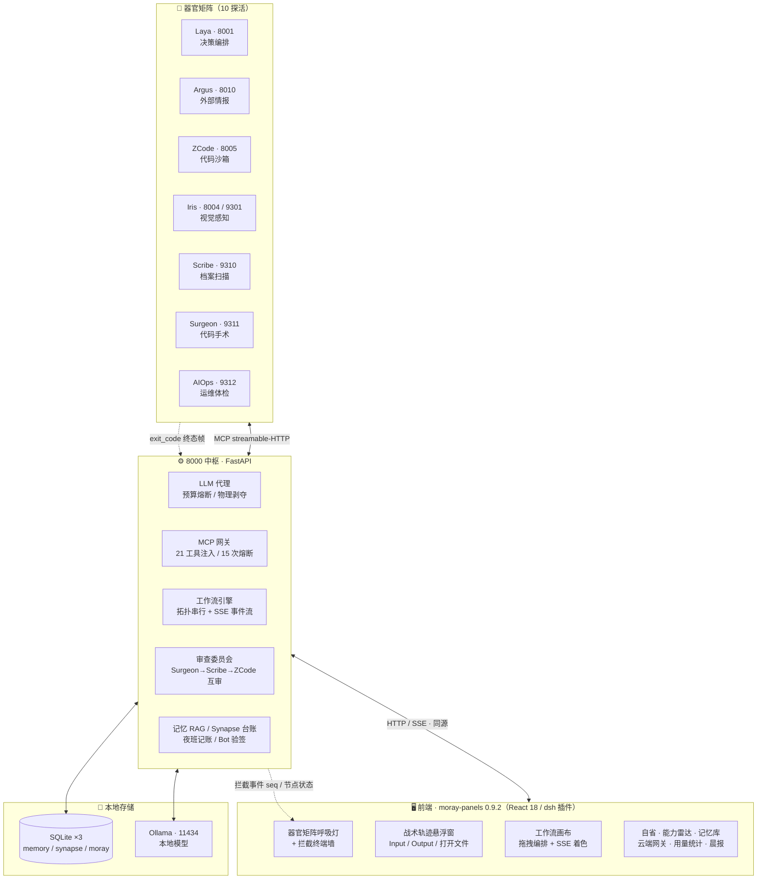
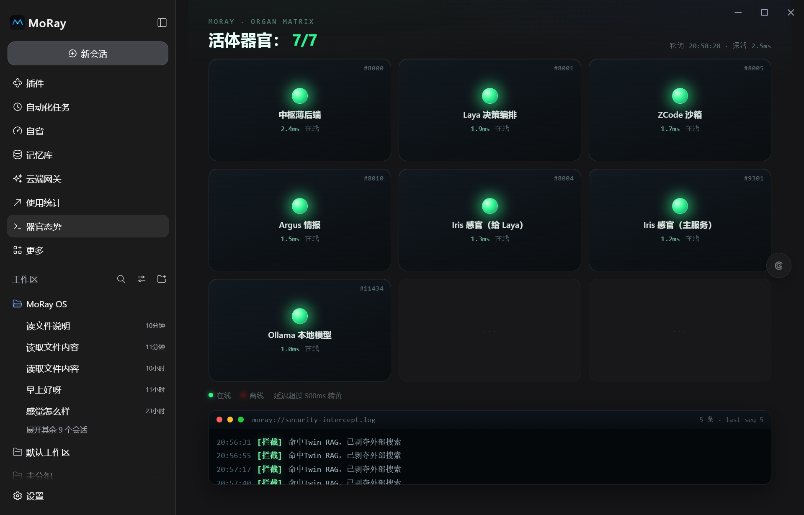
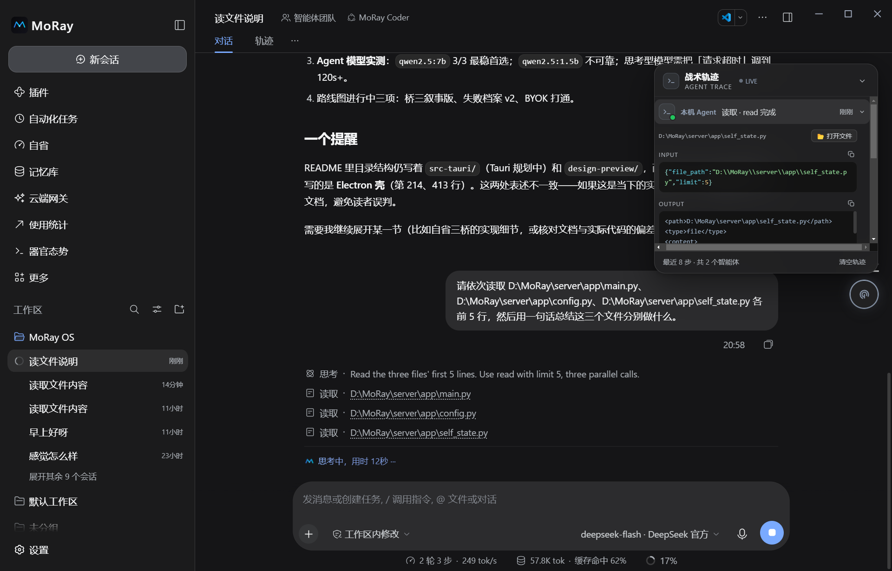
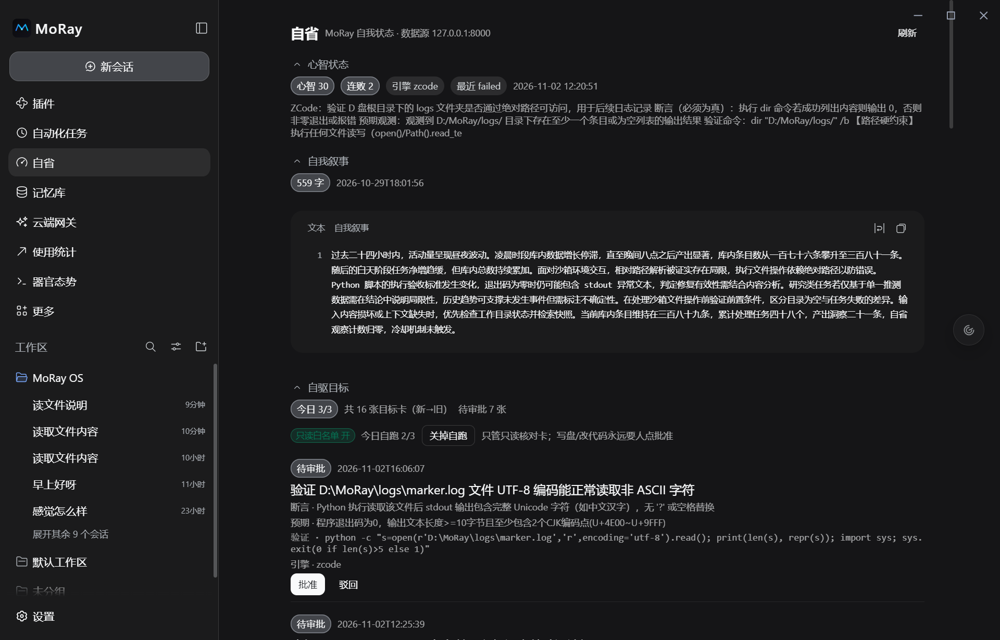
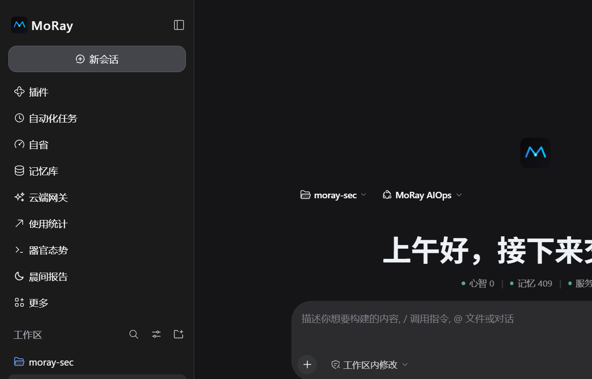
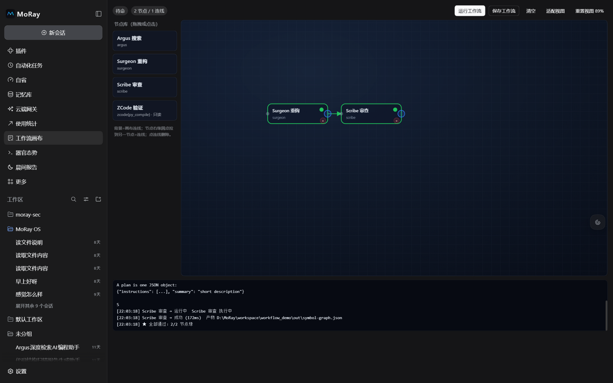

<div align="center">

# 🐟 MoRay

**Mo（克制）+ Ray（光）**

### 本地优先、会自省、可编排的 AGI 中枢

> 让 Agent 在你自己的机器上干活——
> **每一次工具调用都看得见，每一次失败都有判据，每一次拦截都留痕。**

[](LICENSE)
[](https://www.python.org/)
[](https://fastapi.tiangolo.com/)
[](https://react.dev/)
[](https://www.electronjs.org/)
[]()
[]()

**快速跳转：[核心亮点](#-核心亮点-the-killer-features) · [架构](#️-架构) · [快速开始](#-快速开始) · [视觉展示](#-视觉展示) · [安全与承诺](#️-安全与承诺)**

</div>

---

## 🌟 一句话

大多数 Agent 是「你问，它答，然后你祈祷它真的做了」。

MoRay 把三件事做成了**物理事实**：

| 问题 | 大多数 Agent | MoRay |
|---|---|---|
| 它到底做了什么？ | 一段自然语言总结 | **工具级 Input / Output 轨迹，可直达源文件** |
| 它成功了吗？ | 模型自己说「已完成」 | **真实 `exit_code` 判据，模型无权定义成功** |
| 它知道自己失败了吗？ | 不知道，或忘记 | **能力雷达看板 + `mental_score` 痛觉，写进自我叙事** |

---

## 🔥 核心亮点（The Killer Features）

### 1. 🫀 器官矩阵与战术轨迹

**10 个器官、3 秒一轮真 TCP 探活**，一屏看清整个机体的生死与延迟；悬停在输入台上方的**战术轨迹**（`shell.overlay` 槽位，不遮挡输入台）把每次工具调用摊开给你看：

- 每一次调用实时上轴——**工具名、成败、耗时、入参、返回值**
- 点开即见 `INPUT` / `OUTPUT` 代码块，JSON 自动着色，**`📂 打开文件`** 直达系统编辑器
- 采集在 **Host 进程**（`tools/pre-execute` + `tools/result` 钩子），浏览器侧永远拿不到的执行细节，这里拿得到
- 观测旁路环形缓冲 + 截断——**绝不反噬主链路**

> 不是「日志里翻」，是「看着它做」。

### 2. ⚖️ 多智能体代码审查委员会

**Surgeon 动手 → Scribe 审查 → ZCode 验证** 的真实互审闭环（路线一落地，全部真器官、真 MCP）：

- **Surgeon** 对 git 仓库应用重构计划，自验通过才 commit、失败整体回滚
- **Scribe** 扫描产出符号图，按 `(file, kind, lineno)` 做符号三方 diff——改名不算丢、真丢才打回
- **ZCode** 在隔离沙箱写独立校验脚本，委员会对真实目标文件跑 **py_compile 权威闸**
- 失败自动打回修改方重试（≤2 轮），全程逐事件上轴、战术轨迹里看得到每个身份

> 三票全绿才算过——**任何一个器官都不能既当运动员又当裁判**。

### 3. 🎛️ 可视化工作流画布

**零第三方依赖的纯 SVG 编排画布**（moray-panels 0.9.2，reactflow 体积会拖慢壳加载，刻意手写）：

- 左侧节点库：Argus 搜索 / Surgeon 重构 / Scribe 审查 / ZCode 验证，**拖拽或点击入画布**
- 拖节点连线、背景平移、滚轮缩放、8px 网格吸附、适配视图——手感对齐主流画布产品
- 运行时引擎按依赖**拓扑序串行执行**，失败自动短路下游；**SSE 实时推送节点状态**：等待=灰 / 运行中=闪烁蓝 / 成功=绿 / 失败=红
- 节点动作走**白名单硬编码**，画布永远开不出任意 MCP 调用面；草稿自动持久化，切面板不丢

> 把「多器官协同」从代码里的一段 JSON，变成你拖出来的一条线。

<!-- 📷 画布实拍占位：docs/assets/workflow_canvas.png（运行中=闪烁蓝 / 成功=绿 的着色流转） -->

### 4. 🧠 自我认知（能力雷达）

能看清自己成功率的**元认知系统**——MoRay 知道自己每个器官好不好使：

- 每个器官工具的**成功率 / 平均耗时 / 失败归因 / 最近调用**，全部从真实审计流水聚合，零自评、零美化
- 每行悬停出毛玻璃卡片：调用次数、纯执行口径成功率、失败主因
- `mental_score`（0–100）随真实事件流动：**成功 +5 / 失败 −10**；自我叙事每天生成，内容只从记忆库统计里读——**不编造、不美化**
- 30 分钟一轮自省循环：探活器官、读预算闸、扫 ERROR、统计未闭合链

> 「我做了什么」不是比喻，是从自己的流水里读出来的。

<details>
<summary>点击展开：自省层的四级边界（为什么它只记录、不行动）</summary>

桥一 / 桥二 / 桥三严格守住**级别边界**：

- **1 级 · 记录**：发现异常写日志 ✅
- **2 级 · 标记**：标「这里需要关注」 ✅
- **3 级 · 建议**：给出「应该改 X」 ⚠️ 未做
- **4 级 · 执行**：自己改 ❌ 深水区，不做

**「可逆的、参数级的 → 可以自动；不可逆的、代码级的 → 必须问人。」**

**这不是能力问题，是责任问题。**

</details>

### 5. 🕊️ 本地优先的静默体验

- Electron 壳 `whenReady` 先探活 8000、必要时 `windowsHide` 拉起后端，**不弹黑框**
- 双击桌面图标 → 静默拉起全量后端 → 抓到 token → 直接进工作台，**全程零终端窗口**
- 关闭窗口按托盘策略收尾，不留孤儿进程（看门狗 3s 心跳救活）
- 记忆 / 会话 / 审计全部落本地 SQLite；云端 Key 只存 `.env`，**BYOK、数据不出本机**

<details>
<summary>点击展开：七大关键设计决策（工程取舍全记录）</summary>

以下七条来自 v3.x 的工程实践，至今仍是代码里能被验证的约束。

**1. 双存储 + 离线降级** —— 以 IndexedDB 为基线，后端在线时双写 SQLite；不可达自动回退，恢复后「较新者胜」补同步。

**2. 一份产物、两种部署** —— `parts/` 分片经 `assemble.py` 幂等拼装为单文件前端，`file://` 直开与 FastAPI 同源托管共用一份产物。

**3. 智能路由与容错** —— 复杂度分级选模型；失败模型短期熔断 + 半开试探，结合 Ollama `/api/ps` 亲和已驻留模型。

**4. 成本精确可控** —— 服务端 `usage` 精确计量 + 语义缓存 + 预算触顶自动降级，本地免费、云端省钱包里可见。

**5. 安全与诚实** —— SQL 全参数化、CORS 精确正则、Key 只落 `.env`、能力边界不夸大。

**6. MCP 安全同源** —— MCP 调用与前端调用共用同一执行入口，七层路径防护、审批、审计完全一致；工作流画布的节点动作是白名单，不是任意 MCP 旁路。

**7. 自省只记录、不行动** —— 只做「记录 + 标记」，不越级执行。可逆的自动、不可逆的问人。

</details>

---

## 🏗️ 架构



**十器官探活（3 秒一轮真 TCP 探测，面板实测 10/10）**

| 端口 | 器官 | 职责 |
|---|---|---|
| 8000 | 中枢薄后端 | FastAPI 网关：代理 / 记忆 / 预算 / 工作流 / 自省 / Bot |
| 8001 | Laya | 决策与任务编排 |
| 8005 | ZCode | 代码沙箱执行（真实 exit code） |
| 8010 | Argus | 外部情报检索与深度研究 |
| 8004 | Iris（JSON-RPC） | 视觉感知（供 Laya 调用） |
| 9301 | Iris（SSE） | 视觉感知（主服务） |
| 9310 | Scribe | 仓库扫描与符号图（审查之眼） |
| 9311 | Surgeon | 代码手术与自验回滚（审查之手） |
| 9312 | AIOps | 运维体检（审查之第三票储备） |
| 11434 | Ollama | 本地模型推理 |

<details>
<summary>点击展开：MCP 外部接入与本机 Agent 详情</summary>

### 🔌 MCP Server（SSE + JSON-RPC 2.0，零新增依赖）

后端启动后，MCP SSE 地址为：

```
http://127.0.0.1:8000/api/mcp/sse
```

在 Claude Desktop / Cursor / Cherry Studio 的 MCP 配置中填入此地址即可。

**默认只放行 6 个只读工具**（外部客户端默认只能看，不能改）：

| 工具 | 作用 |
|---|---|
| `list_directory` | 列目录 |
| `read_file` | 读文件（UTF-8，默认 64KB 上限） |
| `find_files` | 按通配符递归查找（最多 1000 条） |
| `search_text` | 全文检索（支持正则，最多 200 条命中） |
| `list_processes` | 进程列表（按内存排序） |
| `system_info` | OS / CPU / 内存 / 磁盘概览 |

如需授权写操作，设置环境变量 `MORAY_MCP_ALLOWED_TOOLS=read_file,write_file,create_file` 后重启后端。**放行后仍走 `_safe_path` 等全部防护，且与前端调用共用同一个执行入口。**

### 🖥️ 本机 Agent（11 个受控工具）

- **文件操作**：列目录、读文件、写文件（自动建目录）、新建文件（绝不覆盖）、移动/重命名、精确编辑（`old_str` 唯一匹配校验）
- **搜索与查找**：通配符递归查找、全文检索（支持正则）
- **系统信息**：进程列表、系统概览
- **只读白名单命令**：`git status/log/diff/branch`、`python/node/npm --version`、`where <名称>` ——**无 shell、无管道、单命令 15 秒超时**
- **多步任务编排**：先列计划再逐步执行，失败自动重试、超限跳过防死循环
- **人工审批**：`write/edit/命令` 执行前展示 unified diff 预览，Enter 允许 / Esc 拒绝
- **全程审计**：每次工具调用（含被拒绝的）落库可回溯，支持确定性回放

### 🧭 模型与智能路由

- 🐏 同时接入 **Ollama 本地模型**与任意 **OpenAI 兼容云端**，界面内切换 / 测试 / 拉取模型
- 🧭 **智能路由按难度分流**：简单任务自动选最小模型省成本，复杂任务选最强模型保正确
- ❄️ **失败熔断 + 已驻留亲和**：连续失败的模型短期冷却，优先复用已在显存中的模型
- 🧠 **深度思考三态** · ⚖️ **多模型对比双流输出** · 💰 **usage 精确计费 + 预算阈值 + CSV 导出**

</details>

---

## 🚀 快速开始

### 环境准备

| 依赖 | 版本 | 说明 |
|---|---|---|
| Windows | 10 / 11 | 当前主力平台（PowerShell / 批处理脚本） |
| Python | **3.10+**（推荐 3.12） | 后端与脚本 |
| Node.js | 18+（推荐 20+） | 桌面壳 / Harness 前端 |
| Ollama | 最新 | 本地模型（全部使用云端模型时可缺省） |

### 一键启动（推荐）

```bat
:: 1) 后端：自动建 venv、装依赖、起 8000、打开浏览器
双击  启动MoRay.bat

:: 2) 桌面端（可选）：静默拉起后端 + Harness，无黑框
双击  electron-app\MoRay.lnk
```

### 手动启动（调试用）

```bat
:: 后端
server\.venv\Scripts\python.exe -m uvicorn server.app.main:app --host 127.0.0.1 --port 8000

:: 全部器官（Laya / Argus / ZCode / Iris / Scribe / Surgeon / AIOps / Ollama…）
start_all_services.bat
```

### 配置

```bat
copy server\.env.example server\.env
:: 编辑 server/.env，填入你自己的模型地址与 Key（.env 已被 .gitignore 屏蔽）
```

> **Key 永远不会进仓库。** 云端 Key 只写本机 `.env` 或本地 SQLite；前端只向 `127.0.0.1` 发请求。

---

## 📸 视觉展示

### 图 1 · 器官矩阵与拦截终端墙



> 呼吸灯矩阵真 TCP 探活（延迟实时刷新）；下方终端墙是**真实拦截留痕**——Twin RAG 命中后外部搜索被物理剥夺。

### 图 2 · 战术轨迹展开 Input / Output



> 一次真实 `read` 工具调用：JSON 着色、文件路径直达、每块独立复制。

### 图 3 · 自省心智面板



> `mental_score`、连败计数、自我叙事、自驱目标队列——全部来自本地流水，不经 LLM 美化。

### 图 4 · 能力雷达（元认知）



> Surgeon 100%、Scribe 100%、Argus 80%——每个器官的真实成功率、平均耗时与失败归因，悬停出完整统计卡片。**Agent 第一次能看清自己几斤几两。**

### 图 5 · 可视化工作流画布（占位）

<!--  -->

> 📷 **截图占位**：拖入 Surgeon → Scribe 连线点运行，节点灰 → 闪烁蓝 → 双绿的着色流转（截图文件 `docs/assets/workflow_canvas.png` 待补）。

---

## 🛡️ 安全与承诺

| 承诺 | 实现方式（可验证） |
|---|---|
| **数据不出本机** | 记忆 / 会话 / 审计全部落本地 SQLite（`server/data/*.sqlite3`，已被 gitignore） |
| **Key 不进仓库** | `.env` + `*.sqlite` 全量忽略；仓库只留 `.env.example` 模板 |
| **防幻觉拦截** | Twin RAG 强命中时，**从请求体里物理摘除外部搜索工具**——模型不是「被劝住」，是**没有这个工具可调**；预算耗尽同理熔断并留痕 |
| **成功由判据定义** | 代码执行取真实 `exit_code`；审查委员会以 py_compile 与符号 diff 为权威闸 |
| **画布不是旁路** | 工作流节点动作白名单硬编码（`NODE_TOOLS`），写盘型动作不进画布；器官调用全走审计过的 MCP 网关 |
| **外呼可审计** | Bot 入站 `X-Signature`（HMAC-SHA1）**fail-close**：签名错直接 401，不回落 |
| **观测只回环** | 轨迹 / 器官路由仅绑 `127.0.0.1`，同源校验后才返回 |

> **能力边界（如实声明）**：当前主力平台是 Windows；前端面板以 `moray-panels` 插件形态挂在 dsh Harness 上；本地模型推理质量取决于所选模型；未实现「全自动改系统文件」——写盘/改代码永远需要人点批准。

---

## 🧰 技术栈

**后端** FastAPI · SQLite（FTS5 + sqlite-vec）· httpx · uvicorn · MCP（streamable-HTTP 网关）
**前端** React 18 · moray-panels 0.9.2（`shell.overlay` / `main` / `sidebar.panellist` 槽位 · 纯 SVG 画布 · 零新增依赖）
**桌面端** Electron 33（无边框沉浸 · 静默拉起 · 托盘策略 · 看门狗）
**模型** Ollama（本地）· 任意 OpenAI 兼容云端（自备 Key）

<details>
<summary>点击展开：Agent 模型工具调用真机实测（含踩坑建议）</summary>

**实测于 2026-09，统一同一套文件/搜索工具任务，统计「首轮就正确调用工具」的比例。**

| 模型 | 非流式 | 流式 | 结论 |
|---|---|---|---|
| `qwen2.5:7b` | 3/3 | 3/3 | ✅ 最稳，Agent 任务首选 |
| `qwen3.5:9b` / `4b` | 2/3 | 3/3 · 2/3 | ⚠️ 基本可用，偶发漏调 |
| `qwen2.5:1.5b` | 2/3 | 1/3 | ❌ 不可靠 |

> 💡 **思考型模型提示**：`qwen3.5:9b` 等在生成前会先输出大段思考，首 token 延迟较长。如果前端「请求超时」设得太短，会看到「已停止生成」。**建议把「请求超时」调到 120s 或更高。**

**选型结论**：工具调用是硬指标——参数量小于 3B 的模型偶尔「会用工具」，但**不能承担 Agent 任务**（漏调 = 任务静默失败）。这也是 MoRay 把「失败必须留痕」做成基础设施的原因。

</details>

---

## 📄 开源协议与致谢

**License: [MIT](LICENSE)** — Copyright (c) 2026 莫光良 (aliangmo2026)

感谢这些项目让「本地优先的 Agent 工作台」成为可能：

- [FastAPI](https://fastapi.tiangolo.com/) / [uvicorn](https://www.uvicorn.org/) — 薄后端底座
- [Ollama](https://ollama.com/) — 本地模型推理
- [DeepSeek Harness (dsh)](https://github.com/deepseek-ai/deepseek-harness) — 可插拔的前端运行时
- [React](https://react.dev/) · [Electron](https://www.electronjs.org/) · [SQLite](https://www.sqlite.org/)

> 如果 MoRay 让你对「Agent 到底做了什么」这件事多了一点把握，欢迎 Star ⭐、提 Issue、或者直接读代码——**每一层都可验证**。
